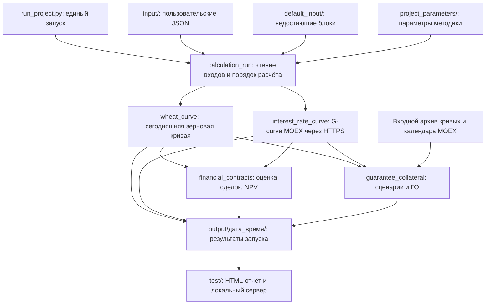

# Карта проекта

Эта карта описывает текущий код: что запускается, откуда берутся данные, где находится математика и куда записывается результат. Для установки начни с [README](README.md#первый-запуск-на-windows), для форматов входа открой [input/README.md](input/README.md).

## Общая схема



Сделки портфеля поступают через общий вход в NPV и ГО. ГО использует ту же функцию денежной оценки сделки, что и NPV. Редактирование портфеля на странице повторяет оценку на кривых выбранного запуска; подготовленные сценарии не генерируются заново.

## Где что лежит

```text
wheat-forward-curve/
    README.md                         Установка и описание зернового расчёта
    PROJECT_MAP.md                    Эта карта
    RUNNING_PROJECT.md                Общий запуск, результаты, мини-фронт
    MODELING_DECISIONS.md              Согласованные допущения и отложенные решения
    VERIFICATION.md                    Результаты проверок по этапам
    pyproject.toml                    Метаданные и сборка Python-пакетов
    requirements.txt                  Pillow для PNG
    requirements-margin.txt           NumPy и SciPy для статистики ГО

    run_project.py / run_project.bat   Основной запуск всего проекта
    run.py / run.bat                   Отдельный запуск только зерновой кривой
    run_discount_factor_calculation.py Отдельный запуск дисконт-факторов
    run_portfolio_margin_calculation.py Отдельный запуск ГО

    input/                            Пользовательские входные JSON
    default_input/                    Фиксированные комплектные данные
    project_parameters/               Общий файл параметров и его загрузчик
    calculation_run/                  Оркестрация запуска, файлы и Excel
    wheat_curve/                      Математика зерновой кривой
    interest_rate_curve/              Загрузка G-curve и дисконтирование
    financial_contracts/              Модели сделок и денежная оценка
    guarantee_collateral/             История, сценарии и ГО портфеля
    generator/                        Явное создание демонстрационных данных
    test/                             Мини-фронт результатов, не тесты Python
    tests/                            Автоматические тесты Python
    examples/                         Маленькие примеры и локальный снимок G-curve
    output/                           Новая папка результатов на каждый общий запуск
    .github/workflows/tests.yml        Автотесты Windows и Ubuntu на GitHub
```

`input/` и `output/` отделены от кода. Пользовательские JSON, результаты и `.venv/` исключены из Git. В `default_input/` хранятся только распространяемые демонстрационные данные. `examples/` содержит также старый небольшой вход для `run.py`, это не комплект общего запуска.

## Входные данные

| Где | Что передаётся | Кому нужно |
|---|---|---|
| `input/run_settings.json` | Объект с необязательной `calculation_date` | Выбор даты общего запуска; без неё используется дата Москвы, если нет `--date` |
| `input/wheat_curve_input.json` | Объект с датами, массивом `previous_curve` и массивом событий `events` | Сегодняшняя зерновая кривая |
| `input/portfolio_margin_input.json`: `trades` | Массив сделок с направлением, объёмом, ценой, датами фиксации и оплаты | NPV и ГО |
| Тот же файл: `history` | Массив дневных снимков; каждый содержит 39 зерновых цен и 39 дисконт-факторов | Калибровка и сценарии ГО; NPV архив не требует |
| `input/moex_trading_calendar.json` | Объект с диапазоном покрытия и массивом торговых дат | Проверка архива и перевод горизонта ГО в календарную дату |
| `project_parameters/default_calculation_parameters.json` | Объект с разделами `forward_curve` и `margin`, версией схемы и происхождением параметров | Пороги зернового расчёта и настройки риска |
| MOEX ISS через HTTPS | Ответ JSON с параметрами и контрольными значениями G-curve на дату расчёта | Дисконт-факторы; в общем запуске это не входной файл пользователя |

В JSON цены и объёмы удобно передавать десятичными строками, даты в формате `YYYY-MM-DD`. Полная схема событий описана в [README](README.md#сегодняшние-события), история и сделки описаны в [руководстве ГО](guarantee_collateral/README.md).

В обычном режиме отсутствующий блок берётся целиком из одноимённого файла `default_input/`. Пустой массив, `null` и ошибочный блок не заменяются. Происхождение блоков записывается в журнал запуска. В режиме `--example` пользовательский `input/` игнорируется и используется фиксированная дата комплектного набора.

Комплектный набор сейчас содержит зерновой день, но не полный архив и портфель для ГО. Генератор не достраивает их при обычном запуске. Наличие кода модуля не означает наличие всех входов для него.

## Где находится логика

| Файл | Что делает и зачем выделен |
|---|---|
| [run_project.py](run_project.py) | Разбирает аргументы команды, запускает расчёты, создаёт отчёт и при `--serve` оставляет сервер работающим. Это основная точка входа, не место финансовых формул. |
| [calculation_run/runner.py](calculation_run/runner.py) | `run_calculations` задаёт порядок модулей и сохраняет их результаты. `RunResult` держит кривые и подготовленную модель в памяти для пересчётов. Ошибка одного модуля не удаляет результаты остальных. |
| [calculation_run/files.py](calculation_run/files.py) | Строго читает JSON общего запуска, выбирает пользовательский или комплектный блок, копирует использованные входы, создаёт уникальную папку и пишет JSON. Отделён от математики для воспроизводимости. |
| [calculation_run/excel_export.py](calculation_run/excel_export.py) | Записывает сегодняшние 39 узлов в XLSX. Для создания файла не нужен установленный Excel. |
| [project_parameters/__init__.py](project_parameters/__init__.py) | Загружает общий файл параметров. Значения лежат в JSON, а не распределены между формами фронта. |
| [wheat_curve/calculator.py](wheat_curve/calculator.py) | Публичная функция `calculate`: проверка массивов, вызов дневного расчёта, итоговые узлы и диагностика. Ядро возвращает структуры Python с Decimal, не пишет файлы и не обращается к сети. |
| [wheat_curve/domain/models.py](wheat_curve/domain/models.py) | Типы событий, заявок, сделок и узловых параметров. Это общие структуры зернового ядра. |
| [wheat_curve/domain/tenors.py](wheat_curve/domain/tenors.py) и [dates.py](wheat_curve/domain/dates.py) | Сетка 39 сроков, их фактические даты и 160 моментов срезов. Календарные сроки кривой не следует путать с торговым календарём горизонта ГО. |
| [wheat_curve/engine/order_book.py](wheat_curve/engine/order_book.py) и [event_processor.py](wheat_curve/engine/event_processor.py) | Восстанавливают остатки заявок по событиям и формируют состояния стакана. Поэтому входом служит журнал за день, а не только последний стакан. |
| [wheat_curve/domain/emmi.py](wheat_curve/domain/emmi.py) | Относит наблюдение с произвольной датой экспирации к одному точному или двум соседним узлам. Это перенос исходных наблюдений, не интерполяция готовой кривой. |
| [wheat_curve/engine/daily_calculator.py](wheat_curve/engine/daily_calculator.py) | Считает VWAP сделок, глубину и спред срезов, дневную цену по заявкам и диагностику каждого срока. |
| [wheat_curve/engine/multi_day_calculator.py](wheat_curve/engine/multi_day_calculator.py) | `combine_tenor` объединяет цены по сделкам и заявкам или переносит прежнюю цену того же срока. В файле также сохранена оркестрация нескольких дней; основной `calculate` использует из него объединение узла. |
| [wheat_curve/domain/curve.py](wheat_curve/domain/curve.py) | `interpolate` и `log_linear_price` строят цены между узлами: линейно по времени интерполируется ln цены. Без экстраполяции и соединения отсутствующих соседних цен. |
| [wheat_curve/plotting.py](wheat_curve/plotting.py) | Сохраняет PNG предыдущей и сегодняшней кривых. Отделён от расчёта, чтобы зерновое ядро не требовало Pillow. |
| [interest_rate_curve/download_moex_g_curve.py](interest_rate_curve/download_moex_g_curve.py) | HTTPS-загрузка и проверка G-curve, модель `MoexGCurve`, локальные снимки для отдельного запуска. Общий запуск не использует скрытую подмену сети снимком. |
| [interest_rate_curve/calculate_discount_factors.py](interest_rate_curve/calculate_discount_factors.py) | Интерфейс `DiscountCurve` и получение `D` для дат платежей. Потребителю дисконтирования не нужно знать формат ответа MOEX. |
| [financial_contracts/forward_valuation.py](financial_contracts/forward_valuation.py) | `ForwardTrade`, `NodeCurves`, `price_forward`: проверка сделки и её NPV. Единая денежная оценка используется и внутри сценариев ГО. |
| [guarantee_collateral/market_history.py](guarantee_collateral/market_history.py) | Проверяет архив, упорядочивает узлы, восстанавливает нулевые ставки из дисконт-факторов. Даёт статистике согласованные массивы истории. |
| [guarantee_collateral/trading_calendar.py](guarantee_collateral/trading_calendar.py) | Проверяет покрытие календаря, отсутствие пропущенных торговых дней и вычисляет конец горизонта риска. |
| [guarantee_collateral/fhs_statistics.py](guarantee_collateral/fhs_statistics.py) | Калибровка GARCH, исторические и FHS-сценарии, переоценка и хвостовые меры риска. Статистические операции используют NumPy/SciPy и float64. |
| [guarantee_collateral/calculate_portfolio_margin.py](guarantee_collateral/calculate_portfolio_margin.py) | Публичный API ГО, настройки и ограничения сделок. `prepare_portfolio_margin` готовит модель один раз, `PreparedPortfolioMargin.calculate` повторно считает изменённый портфель. |
| [test/report.py](test/report.py) и [local_server.py](test/local_server.py) | Создают HTML и обслуживают формы NPV/ГО на `127.0.0.1`. Фронт показывает результаты, но не задаёт методику. |
| [generator/create_fixed_demo_inputs.py](generator/create_fixed_demo_inputs.py) | Отдельная команда создания зернового примера по `generator/parameters.json`. Обычный запуск её не вызывает и не перегенерирует комплектные данные. |

## Что происходит при общем запуске

`run_project.py` передаёт аргументы в `run_calculations`. Тот создаёт папку запуска, выбирает дату и копирует файл параметров. Затем выбираются и проверяются зерновые входы, строятся узлы, дневная интерполяция, Excel и PNG.

Независимо от успеха зернового расчёта загружается G-curve на ту же дату. При наличии обеих полных кривых формируются структуры для денежной оценки. NPV можно считать без исторического архива; для сохранённого исходного NPV также нужен корректный входной портфель.

Для ГО проверяется архив. В его рабочую копию добавляется сегодняшний рассчитанный снимок; если сегодняшний снимок уже был, он заменяется с записью в журнал. Исходный файл не меняется. Затем проверяется календарь, калибруется модель, сохраняются сценарии и рассчитывается портфель.

После расчётов создаётся HTML. С `--serve` Python остаётся работать: форма NPV вызывает оценку, редактор портфеля вызывает подготовленную модель ГО. Новые введённые на странице сделки и результаты этих пересчётов на диск не записываются. Без сервера HTML остаётся статическим отчётом.

## Что находится в папке результата

| Путь внутри `output/дата_время/` | Содержимое |
|---|---|
| `report.html` | Мини-фронт: кривая, состояние модулей и формы пересчёта |
| `run_info.json` | Источники блоков, даты, контрольные суммы, предупреждения и ошибки модулей |
| `parameters.json` | Копия общего файла настроек этого запуска |
| `input/` | Использованные исходные JSON, полученная G-curve и эффективные объединённые входы |
| `results/curve.json`, `audit.json` | Узловая зерновая кривая и подробная диагностика расчёта |
| `results/effective_forward_parameters.json` | Узловые параметры с учётом переопределений входа |
| `results/interpolated_curve.json` | Цены на календарные даты между узлами |
| `results/discount_factors.json` | Сегодняшние дисконт-факторы на 39 датах узлов |
| `results/npv.json`, `portfolio_margin.json` | Оценка исходного портфеля и его ГО |
| `results/prepared_scenarios.npz` | Сценарные матрицы NumPy, по 39 столбцов; читать с `allow_pickle=False` |
| `excel/today_curve.xlsx` | Сегодняшняя узловая кривая для Excel |
| `images/` | PNG предыдущей, сегодняшней кривых и их сравнения |

Файлы неуспешных модулей могут отсутствовать. Подробное дерево результата и значения кодов завершения приведены в [RUNNING_PROJECT.md](RUNNING_PROJECT.md#результат). JSON сохраняет Decimal строками; Excel предназначен для просмотра, а не точного финансового обмена.

## Где менять настройки и что важно не перепутать

Пороги объёма, глубины, спреда и настройки ГО меняются в [project_parameters/default_calculation_parameters.json](project_parameters/default_calculation_parameters.json). Свой файл можно передать через `--parameters`. `generator/parameters.json` управляет только созданием синтетического примера, не заменяет параметры методики.

Зерновая кривая использует log-linear интерполяцию. Перенос наблюдений EMMI использует свою формулу. NPV получает дисконт-факторы из аналитической G-curve, а сценарное ГО интерполирует узловые нулевые ставки линейно. Это разные задачи; одинаковое слово «кривая» не означает один общий алгоритм интерполяции. Линейная ценовая ось графика также не меняет log-linear расчёт.

Финансовая оценка использует Decimal, статистика ГО использует float64 с явным преобразованием на границе. Текущий ГО поддерживает только сделки с фиксацией строго после конца горизонта риска и в пределах доступных кривых. Источник входных заявок гарантирует отсутствие пересечения стакана также после EMMI.

Причины согласованных модельных решений и отложенные расширения записаны в [MODELING_DECISIONS.md](MODELING_DECISIONS.md). Текущие формулы ГО и поля архива приведены в [guarantee_collateral/README.md](guarantee_collateral/README.md), дисконтирование описано в [interest_rate_curve/README.md](interest_rate_curve/README.md).

## С чего читать код

Чтобы понять приложение целиком, открой `run_project.py`, затем `calculation_run/runner.py` и `calculation_run/files.py`. Это путь от команды до модулей и файлов результата.

Чтобы проверить математику зерновой кривой, начни с `wheat_curve/calculator.py`, затем переходи к `event_processor.py`, `emmi.py`, `daily_calculator.py`, `combine_tenor` и `domain/curve.py`. Маленький вход для ручной проверки: `examples/minimal_input.json`.

Чтобы разобраться в ГО, прочитай его README, затем `calculate_portfolio_margin.py`, `market_history.py`, `trading_calendar.py` и `fhs_statistics.py`. Денежная формула находится отдельно в `financial_contracts/forward_valuation.py`.

Для проверки поведения открой `tests/`. `test_calculator.py` проверяет зерновое ядро, `test_discount_factors.py` дисконтирование, `test_portfolio_margin.py` ГО, `test_run_project.py` общий запуск и HTTP, `test_release_regressions.py` исправленные ошибки, `test_report_rendering.py` отображение, `test_fixed_generator.py` комплектный зерновой набор.
